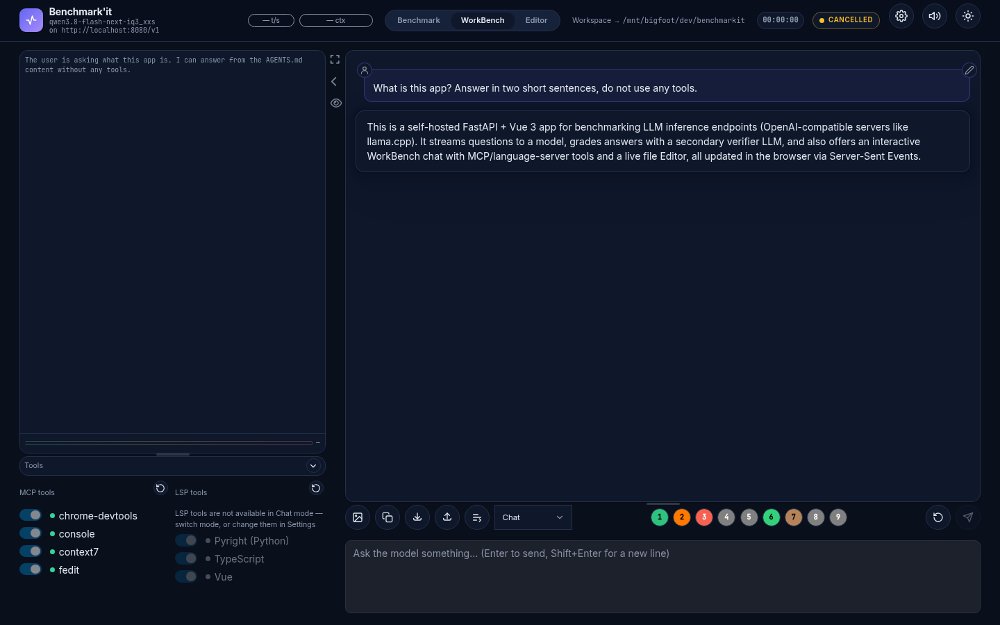
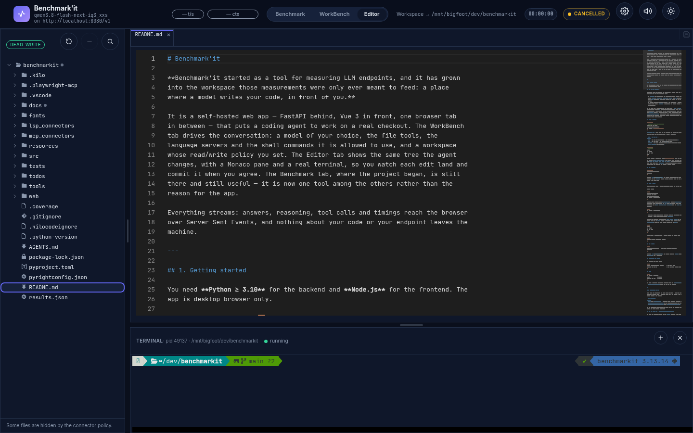
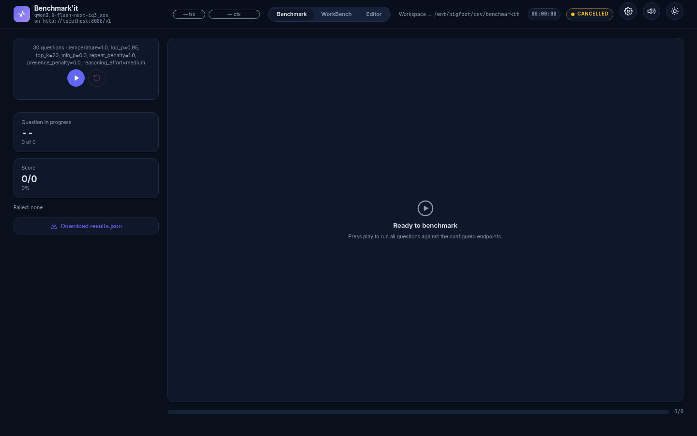

# Benchmark'it

**Benchmark'it started as a tool for measuring LLM endpoints, and it has grown
into the workspace those measurements were only ever meant to feed: a place
where a model writes your code, in front of you.**

It is a self-hosted web app — FastAPI behind, Vue 3 in front, one browser tab
in between — that puts a coding agent to work on a real checkout. The WorkBench
tab drives the conversation: a model of your choice, the file tools, the
language servers and the shell commands it is allowed to use, and a workspace
whose read/write policy you set. The Editor tab shows the same tree the agent
changes, with a Monaco pane and a real terminal, so you watch each edit land and
commit it when you agree. The Benchmark tab, where the project began, is still
there and still useful — it is now one tool among the others rather than the
reason for the app.

Everything streams: answers, reasoning, tool calls and timings reach the browser
over Server-Sent Events, and nothing about your code or your endpoint leaves the
machine.

---

## 1. Getting started

You need **Python ≥ 3.10** for the backend and **Node.js** for the frontend. The
app is desktop-browser only.

### Git Bash on Windows 🪟

On Windows, **Git for Windows is not optional**. It is what gives the two most
useful parts of the app a vocabulary there:

- The `console` MCP connector runs its whitelisted commands through Git's POSIX
  toolset (`ls.exe`, `grep.exe`, `find.exe`, `mv.exe` in `<Git>\usr\bin`) rather
  than a `cmd` vocabulary, so the same command list behaves the same on both
  systems.
- The Editor's terminal opens **Git Bash** as its shell, over a pseudo-console.
  It never falls back to `cmd.exe` or PowerShell: one working location gets one
  tool vocabulary.

The app looks for an installation in the usual places — `git` on `PATH` first,
then `C:\Program Files\Git`, `%LOCALAPPDATA%\Programs\Git`, Scoop and Chocolatey.
An installation is only accepted when its `usr\bin\ls.exe` is really there, so a
lone `git.exe` cannot be mistaken for one. If yours sits somewhere else, point
`BENCHMARKIT_GIT_BASH_DIR` at its install root. When nothing answers, the
terminal and the connector refuse **in words**, naming every folder they
searched — they never half-work.

### Setup on Windows

```powershell
# 1. Backend — from the project root
py -3.12 -m venv .venv
.venv\Scripts\Activate.ps1
pip install -e ".[mcp,lsp,windows]"
```

`pip install -e .` alone gives you the benchmark, the chat and the Editor; the
extras are what add the rest, and none of them is mandatory:

| Extra | What it adds |
|---|---|
| `mcp` | The MCP SDK and Playwright — the WorkBench connectors. |
| `lsp` | The LSP client — the language-server tools. |
| `windows` | The Editor terminal's pseudo-console driver. Never pulled in on Linux. |
| `test` | `pytest` and its plugins. |

```powershell
# 2. Frontend
cd web
npm install
npm run build
cd ..
```

Node is easiest to manage with [Volta](https://volta.sh), which pins the runtime
per project: `volta install node@22` in the project root, then `npm install -g
volta` once per machine. Volta keeps its shims in `%LOCALAPPDATA%\Volta\bin`, and
those shims shell out to `volta.exe` in `%ProgramFiles%\Volta` — remember both
folders, they come back when you declare a language server.

### Run on Windows

```powershell
.venv\Scripts\Activate.ps1
benchmarkit
```

Then open <http://127.0.0.1:8000>. The Editor's terminal needs Git Bash to be
installed (and the `windows` extra); without either, it shows you what is missing
instead of an empty pane.

### Setup on Linux

Either environment works — pick one virtualenv manager, not both at once.

**Plain venv:**

```bash
cd /path/to/benchmarkit
python -m venv .venv
source .venv/bin/activate
pip install -e ".[mcp,lsp]"
```

**pyenv:** this project ships a `.python-version` naming a `benchmarkit`
virtualenv, which activates when you `cd` into the project. Create that
environment once (`pyenv virtualenv 3.12 benchmarkit`, or let `pyenv install` do
it), then:

```bash
pip install -e ".[mcp,lsp]"
```

> If you use a venv while pyenv is installed, make sure only **one** environment
> is active — pyenv shims otherwise shadow `.venv/bin`.

Then build the frontend. With **Volta**, `volta install node@22` in the project
root is enough and no `PATH` editing is involved; Volta installs under
`~/.volta/bin`, which your shell profile already puts on `PATH`:

```bash
cd web
npm install
npm run build
cd ..
```

Finally, when a connector drives a browser, install its runtime once:

```bash
playwright install --with-deps chromium
```

### Run on Linux

```bash
source .venv/bin/activate     # or: pyenv activate benchmarkit
benchmarkit
```

Then open <http://127.0.0.1:8000>. The terminal pane runs `$SHELL` (falling back
to `/bin/sh`) over a kernel PTY.

### Development (hot reload)

Two processes, on either system:

```bash
uvicorn src.api.server:app --reload      # the API on :8000
cd web && npm run dev                    # Vite on :5173, proxying /api to :8000
```

### Tests

```bash
pip install -e ".[test]"
pytest                # backend
cd web && npm test    # frontend
```

The suite is hermetic: it needs no reachable model, and `BENCHMARKIT_DISABLE_MCP`
/ `BENCHMARKIT_DISABLE_LSP` switch the two hubs off entirely.

---

## 2. Configuring the app

Three files hold everything, and **all three are hot**: a change is picked up by
**Settings → Refresh MCP** / **Refresh LSP**, or by the toggles in the Settings
dialog, without an app restart.

| File | Declares |
|---|---|
| `.env` (from `.env.example`) | Endpoint, model, sampling, verifier, vision flag. |
| `mcp_connectors/externals.json` | The MCP connectors the agent may call. |
| `lsp_connectors/lsp_servers.json` (from `lsp_servers.example.json`) | The language servers. |

The two declaration files may carry API keys, so they are gitignored and their
secrets are never returned by the API.

### The MCP setup file — `mcp_connectors/externals.json`

One entry per connector id, each with an `enable` flag that is the only switch
that counts. Two kinds:

- **`remote`** — a Streamable HTTP endpoint (`url` plus optional `headers`);
- **`local`** — a stdio child the hub starts and owns (`command` as an argv list,
  e.g. launched through `npx`).

Any `url`, `command`, `headers` or `env` value may reference an environment
variable as `${NAME}`, or `${NAME:-fallback}` when the variable is optional. The
reference is expanded when the file is read, using the environment the connector
runs with — the app's own, `.env` included — so one declaration works on every
machine and a secret can stay out of the file. Only the braced `${…}` form is
special, an
expanded value is never re-split into arguments, and an unset name is left
written as-is and reported as a validation note in **Settings → MCP** rather
than blanked.

**On Linux:**

```json
{
  "context7": {
    "type": "remote",
    "enable": true,
    "url": "${MCP_BASE_URL:-https://mcp.context7.com/mcp}",
    "headers": { "CONTEXT7_API_KEY": "${CONTEXT7_API_KEY}" }
  },
  "chrome-devtools": {
    "type": "local",
    "enable": true,
    "command": ["npx", "-y", "chrome-devtools-mcp@latest",
                "--executablePath=/usr/bin/chromium", "--headless"]
  },
  "console": {
    "type": "local",
    "enable": true,
    "description": "Console command",
    "command": ["/home/me/.pyenv/versions/benchmarkit/bin/python",
                "${BENCHMARKIT_PATH_LOCATION}/mcp_connectors/console_mcp.py",
                "--root-dir", "${BENCHMARKIT_PATH_LOCATION}", "--transport", "stdio"]
  },
  "fedit": {
    "type": "local",
    "enable": true,
    "description": "File editor",
    "command": ["/home/me/.pyenv/versions/benchmarkit/bin/python",
                "${BENCHMARKIT_PATH_LOCATION}/mcp_connectors/fedit_mcp.py",
                "--root-dir", "${BENCHMARKIT_PATH_LOCATION}", "--transport", "stdio"]
  }
}
```

**On Windows**, the same entries with the interpreter written the way a Windows
venv lays out — and nothing else about the file changes:

```json
{
  "console": {
    "type": "local",
    "enable": true,
    "description": "Console command",
    "command": ["${BENCHMARKIT_PATH_LOCATION}\\.venv\\Scripts\\python.exe",
                "${BENCHMARKIT_PATH_LOCATION}\\mcp_connectors\\console_mcp.py",
                "--root-dir", "${BENCHMARKIT_PATH_LOCATION}", "--transport", "stdio"]
  },
  "fedit": {
    "type": "local",
    "enable": true,
    "description": "File editor",
    "command": ["${BENCHMARKIT_PATH_LOCATION}\\.venv\\Scripts\\python.exe",
                "${BENCHMARKIT_PATH_LOCATION}\\mcp_connectors\\fedit_mcp.py",
                "--root-dir", "${BENCHMARKIT_PATH_LOCATION}", "--transport", "stdio"]
  }
}
```

The `npx` lines work as they do on Linux — the connector process inherits your
`PATH`, where npm put `npx` — so the only real difference is which Python you
name. Two rules of thumb anyway: the brace closes right after the variable name
(`${BENCHMARKIT_PATH_LOCATION}/web`, never `${BENCHMARKIT_PATH_LOCATION/web}`),
and a backslash inside a JSON string is written twice.

`console` and `fedit` are the two connectors shipped with the app — the shell
command surface and the file-edit surface (read, preview, apply, revert). Batch
mode needs both. They take `--root-dir`, so their reach is bounded by their own
deny-list, and `console` execs one command with no shell: no pipes, no
redirections, no command chains. `chrome-devtools` and `context7` are third-party
and entirely optional.

### The LSP setup file — `lsp_connectors/lsp_servers.json`

Copy the committed example and adapt it. One entry per server id: a stdio
`command`, the `workspaceRoot` it indexes, the file `extensions` it owns and the
`tools` to expose. An enabled server adds `lsp_<id>_<action>` tools —
diagnostics, hover, definition, references, symbols, completion, formatting — to
the WorkBench tab. `${NAME}` expansion works here exactly as it does for MCP.

Install the servers themselves with npm, the same line on either system (the
`lsp` extra only brings the Python client side):

```bash
npm install -g pyright typescript typescript-language-server @vue/language-server
```

**On Linux** — the form of the committed example, where `${VOLTA_BIN:-/usr/local/bin}`
covers both a Volta-managed install and a plain global one:

```json
{
  "pyright": {
    "enable": true,
    "label": "Pyright (Python)",
    "extensions": [".py", ".pyi"],
    "command": ["${VOLTA_BIN:-/usr/local/bin}/pyright-langserver", "--stdio"],
    "workspaceRoot": "${BENCHMARKIT_PATH_LOCATION}",
    "env": { "PATH": "${VOLTA_BIN:-/usr/local/bin}:/usr/local/bin:/usr/bin:/bin" },
    "initializationOptions": { "typeCheckingMode": "standard" },
    "tools": ["diagnostics", "hover", "definition", "references", "document_symbols"],
    "idleShutdownSeconds": 300
  },
  "typescript": {
    "enable": true,
    "label": "TypeScript",
    "extensions": [".ts", ".tsx", ".js", ".mjs", ".cjs", ".json"],
    "command": ["typescript-language-server", "--stdio"],
    "workspaceRoot": "${BENCHMARKIT_PATH_LOCATION}/web",
    "lazy": true,
    "initializationOptions": { "tsserver": { "path": "/usr/local/lib/node_modules/typescript" } },
    "tools": ["diagnostics", "hover", "definition", "references", "document_symbols",
              "completion", "signature_help", "formatting"],
    "idleShutdownSeconds": 300
  },
  "vue": {
    "enable": true,
    "label": "Vue",
    "extensions": [".vue"],
    "command": ["vue-language-server", "--stdio",
                "--tsdk=${BENCHMARKIT_PATH_LOCATION}/web/node_modules/typescript/lib"],
    "workspaceRoot": "${BENCHMARKIT_PATH_LOCATION}/web",
    "lazy": true,
    "tools": ["diagnostics", "hover", "definition", "references", "document_symbols",
              "completion", "formatting"],
    "idleShutdownSeconds": 300
  }
}
```

**On Windows** the same three entries take a different shape, and the two
differences are exactly why a Linux declaration copied verbatim fails there:

```json
{
  "pyright": {
    "enable": true,
    "extensions": [".py", ".pyi"],
    "command": ["pyright-langserver", "--stdio"],
    "workspaceRoot": "${BENCHMARKIT_PATH_LOCATION}",
    "env": { "PATH": "${LOCALAPPDATA}\\Volta\\bin;${ProgramFiles}\\Volta" },
    "initializationOptions": { "typeCheckingMode": "standard" },
    "tools": ["diagnostics", "hover", "definition", "references", "document_symbols"],
    "idleShutdownSeconds": 300
  },
  "typescript": {
    "enable": true,
    "extensions": [".ts", ".tsx", ".js", ".mjs", ".cjs", ".json"],
    "command": ["typescript-language-server", "--stdio"],
    "workspaceRoot": "${BENCHMARKIT_PATH_LOCATION}/web",
    "lazy": true,
    "env": { "PATH": "${LOCALAPPDATA}\\Volta\\bin;${ProgramFiles}\\Volta" },
    "tools": ["diagnostics", "hover", "definition", "references", "document_symbols",
              "completion", "signature_help", "formatting"],
    "idleShutdownSeconds": 300
  },
  "vue": {
    "enable": true,
    "extensions": [".vue"],
    "command": ["vue-language-server", "--stdio",
                "--tsdk=${BENCHMARKIT_PATH_LOCATION}/web/node_modules/typescript/lib"],
    "workspaceRoot": "${BENCHMARKIT_PATH_LOCATION}/web",
    "lazy": true,
    "env": { "PATH": "${LOCALAPPDATA}\\Volta\\bin;${ProgramFiles}\\Volta" },
    "tools": ["diagnostics", "hover", "definition", "references", "document_symbols",
              "completion", "formatting"],
    "idleShutdownSeconds": 300
  }
}
```

- **The `PATH` separator is `;`, not `:`** — and an `env.PATH` *replaces* the
  child's `PATH` wholesale, so it must carry every folder the command resolves
  through: with Volta, both the shim folder and the one holding `volta.exe` and
  `node.exe`, otherwise the shim starts and immediately fails.
- **Write the command as the bare program name.** What npm and Volta install
  under `pyright-langserver` is a `#!/bin/bash` script Windows cannot exec; the
  hub resolves `argv[0]` with `shutil.which` over the child's own `PATH`, which
  honours `PATHEXT` and finds the `.cmd` beside it. When nothing answers the
  name, the server is left at `error` with a sentence naming the command and the
  folders searched.

`${VOLTA_BIN}` is a POSIX idea and there is no conditional in `${…}` — no
platform test, no OS-dependent default — which is why the example file states the
Windows form in a `_windows_note` instead of pretending one string fits both.

Two more knobs worth knowing:

- **`"lazy": true`** spawns a server on its first tool call instead of with the
  app (tsserver's cold start is multi-second and eats RAM). A settings panel
  listing a lazy server as *stopped* is not a failure.
- **`lsp_connectors/restricted-paths.txt`** lists, one prefix per line and in
  both platforms' path forms (`/etc`, `${SystemRoot}`, `${HOME}/.ssh`,
  `${USERPROFILE}/.aws`, …), the roots no `workspaceRoot` may sit inside. A
  language server indexing a secret tree would put that tree in the model's
  context window, so the declaration is refused instead.

### The working location

One value roots every file-touching part of the app — the `--root-dir` of the
local connectors, every `workspaceRoot`, the Editor's tree and the terminal's
starting directory: `BENCHMARKIT_PATH_LOCATION`. It is seeded with the install
directory at startup, so a fresh checkout needs no configuration, and it is
deliberately **not** a `.env` key, so a settings save can neither erase it nor
resurrect a stale value.

**Settings → Working directory** shows the live value and repoints the MCP and
LSP tools at another folder in one step; that change is process-local, and the
next start is back at the install directory. Export the variable (or set it in
`.env`) to pin it permanently. The folder must exist and must not sit under a
restricted path. In a declaration, reference it as `${BENCHMARKIT_PATH_LOCATION}`
— the app defines it for the connectors and the language servers it starts.

That folder gets its own read/write policy in `<working location>/.nojae/read-write-policy.json`,
which answers one question per file — `rw`, `ro` or `hidden` — for the Editor
*and* for the agent's file tools: a folder you mark `ro` is not editable by an
agent either. The file is seeded for you (dependency and build folders come
read-only) and edited outside the app — see
[`docs/POLICY-MANAGEMENT-DOC-EN.md`](docs/POLICY-MANAGEMENT-DOC-EN.md).

### LLM configuration — `.env`

Copy `.env.example` to `.env` and point it at your server. Everything else is
optional and editable later from the Settings dialog:

```bash
SERVER_URL=http://127.0.0.1:8080/v1
SERVER_URL_API_KEY=not-needed
ENDPOINT=my-model
#SUPPORTS_VISION=1                  # enables the WorkBench image attach button
#TEMPERATURE=0.2
#REASONING=off|low|medium|high|xhigh
#MAX_TOOL_ITERATION=25              # tool-loop cap for one WorkBench reply
#VERIFIER_AGENT_SERVERURL=http://127.0.0.1:8080/v1   # second model, Benchmark tab
#VERIFIER_AGENT_ENDPOINT=verifier-model
```

A `.env` save **regenerates the file from a fixed template**: fixed key set and
order, empty optional keys commented out, hand-written extras lost. Add or rename
a key and you change the template, the renderer and the committed example
together.

### Run

Both systems, once the two builds above are done:

```bash
benchmarkit          # API + UI on http://127.0.0.1:8000
```

Nothing else is required — a fresh checkout with no configuration gives you a
working WorkBench and a working Editor; the connectors and servers only decide
how far the agent may reach.

---

## 3. What the app does

### WorkBench — where the work happens 💬



A streaming chat with your configured model, in an **agent mode** you pick from
the composer: **Chat** (no tools at all), **Code** (file tools and language
servers — the mode that implements, and leaves the tree compiling and tested),
**Architect** (reads and asks, writes only a markdown spec), and **Todo builder**,
which turns a spec into a numbered lot of task files and is defined by the app.
A mode replaces the persona sent to the model and decides whether a whole tool
hub reaches it at all; it can only ever narrow what Settings already allows. The
editable modes live in `<working location>/.nojae/agent-modes.json`, seeded for
you and edited outside the app.

**Batch mode** works through a folder of task files — `todos/` by default, files
named `01-slug.md`, `02-slug.md`, …, with `00-…` as the lot's big picture, which
rides on every request. One task is one chat turn; the app never reads a task
body, it only hands the model the path and lets its own connectors open it. A
task counts as finished when its **file has left the folder** — the agent moves
it into `todos/done`, which is its own acknowledgement — so a file still in place
is relaunched with a note saying why, up to three times, after which the lot
aborts. The mode is pinned when the lot launches, the conversation is reset
between tasks, and continuity comes from disk: git and the files that moved.
Batch mode refuses to start unless the connectors it depends on are on.

Around the composer: the reasoning and tool panel (every tool call, its result
and the server that answered), image attach when `SUPPORTS_VISION` is set,
workspace-scoped prompt helpers, a session stopwatch and context-size badge, and
Save / Load of a conversation as a plain JSON file. Markdown renders with KaTeX,
highlighted code and Mermaid diagrams, always through the sanitizer.

### Editor — the same tree, in your hands 🗂



The working location as a file tree and a Monaco pane: create, rename, move and
delete, save with a diff against the last commit, git status badges on the rows,
a search that answers for the same set of files the tree lists, and **one
terminal per connection**, on the platform's pseudo-terminal — `$SHELL` on
POSIX, Git Bash on Windows.

Nothing here is destroyed. Every save keeps the bytes it replaced in a backup
folder, and a delete moves the file into a dated batch under the reserved
`.nojae/trash/` of the current working location (kept 30 days), so a restore is
one `mv` away. `Ctrl`+click a group of rows, right-click, `Move to…`: the set
moves whole in one request, and a file that is open keeps its tab and its
unsaved edits at the new path.

The Editor's writes are the browser's own surface — never reachable from a
connector, a tool or a chat path — and they are refused while a reply streams.
That is asserted by a test rather than trusted.

### Benchmark — the original tool ⏱



Run a question set against the configured model and watch answers, scores,
timings and token/s arrive live. Sets are JSON files in `resources/` —
`legacy`, `78qcm`, `122qcm`, `30hardmath` — and an optional **verifier LLM**
judges each answer against the expected one, so wording differences do not cost
a point. Timing is measured app-side from chunk arrivals, anchored after a model
warm-up, so loading and verification never enter the numbers; token/s counts
completion tokens only. One run at a time, cancellation honoured between
questions and mid-stream, and an answer the server cut short is failed rather
than graded.

### One configuration, one streaming layer

All three tabs call the model through the same client against an
OpenAI-compatible endpoint — llama.cpp, vLLM, or a hosted one — so adding a model
is configuration, never code. Every event the server emits is numbered, so a
reconnecting browser replays what it missed and a refresh loses nothing.
Configuration changes take effect hot: no restart, ever.
